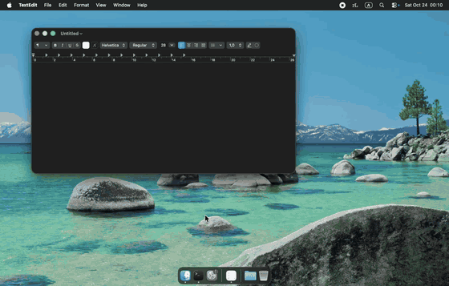

# reLayout

A tiny open-source menu-bar app that instantly retypes text typed in the wrong keyboard layout.

**Website:** [relayout.forfutdinov.com](https://relayout.forfutdinov.com/)



Typed `ghbdsn` instead of `привіт`? Press the hotkey — the word you just typed, or a selection, is retyped in the right layout, and the system input source switches too, so you can keep typing. Works with **any** installed layouts, not a hard-coded pair. macOS; Windows port in preview.

## Install

**macOS:**

```sh
brew install --cask vladforfutdinov/relayout/relayout
```

or download `reLayout.dmg` from the [latest release](https://github.com/vladforfutdinov/reLayout/releases/latest) and drag it to Applications (signed and notarized). On first launch, grant **Accessibility**: System Settings → Privacy & Security → Accessibility → enable reLayout → relaunch.

**Windows (preview):** each release has an installer (`reLayout-windows-<arch>-setup.exe`) and a portable `.exe` for x64 and arm64. They aren't code-signed yet, so SmartScreen asks once ("More info" → "Run anyway"). No auto-update yet — download a newer release to upgrade.

## Use

1. Select the mistyped text — or select nothing right after typing a word to fix that word.
2. Press the hotkey (default: **tap Shift twice**).
3. Press again right away (before typing or clicking anything else) to try the next layout, and once there's none left, to undo.

Only words in the wrong layout are converted: `я сказал ghbdtn` → `я сказал привет`. A word split by a layout switch is fixed too: `ghj` + switch + `сто` → `просто`.

Change the hotkey (combo, modifier tap, or tap sequence) in **rL → Settings…**.

## Auto-correct (optional, off by default)

Fixes wrong-layout words **as you type**, no hotkey:

- Between Cyrillic and Latin layouts (ru/uk ↔ en/de/fr/es/pl/pt), judged by small on-device language models tuned for ≥99% precision.
- Experimental: between similar layouts of different languages (ru ↔ uk).
- Experimental: check with the system spelling dictionary — a real word is never converted into junk, a word the trigrams miss is converted when the dictionary knows its other-layout reading, and one typo inside a wrong-layout word is fixed when the dictionary leaves a single candidate (“ghbddtn” → “привет”). Off by default; uses the system's spell checker on macOS and Windows.
- Skips password fields; terminals, code editors, VMs and remote desktops are excluded by default. Per program you can turn off auto-correct, the hotkey, or both (Settings → Exceptions…); Figma has both off by default — its canvas reads typed text as tool shortcuts.
- Leaves abbreviations alone: a word typed in capitals (IBM, МФЦ) is never auto-corrected — the hotkey still converts it.
- Learns from you: undo a fix (with the hotkey, or just erase it and type the word again — erase and retype a word it left alone to have it fixed again; or fix a word it missed by hand, and it remembers), or correct the same word with the hotkey a few times, and auto-correct follows your choice.
- Optional second hotkey to switch it on and off (Settings → Auto-correct on/off; not set by default). On macOS a dot in the menu-bar icon's corner shows it is on.

How it decides: [ARCHITECTURE.md](docs/ARCHITECTURE.md).

## Privacy

- **Your text never leaves the machine and is never written to disk.** No analytics, telemetry, or account. The only network call is the update check: [Sparkle](https://sparkle-project.org) on macOS (can be turned off), a look at the latest GitHub release on Windows (nothing is downloaded).
- **The clipboard is left untouched** when Accessibility can read the selection.
- **Password fields are skipped.** While macOS Secure Input is on (a password field or a terminal's Secure Keyboard Entry), the system blocks reLayout entirely.
- Only settings and auto-correct's learned words are stored (Settings → Learned words to view or reset).

## Limitations

- Needs at least two keyboard layouts.
- Same-script layouts (e.g. ABC vs German) can't be told apart word by word.

## Build from source

**macOS** — requires only the Command Line Tools (they include Swift; full Xcode works too). The app runs on macOS 13+; no Xcode project and no dependencies, `build.sh` calls `swiftc` directly.

```sh
xcode-select --install   # one-time: Command Line Tools
./scripts/make-cert.sh   # one-time: keeps the Accessibility grant across rebuilds
./scripts/build.sh       # -> dist/ReLayout.app
```

**Windows** — requires Visual Studio Build Tools (MSVC + Windows SDK) and the [Swift toolchain](https://www.swift.org/install/windows/) (6.1+ on x64, 6.3.2+ on arm64). In PowerShell:

```powershell
winget install --id Microsoft.VisualStudio.2022.BuildTools -e --source winget --custom "--add Microsoft.VisualStudio.Component.Windows11SDK.22621 --add Microsoft.VisualStudio.Component.VC.Tools.x86.x64 --add Microsoft.VisualStudio.Component.VC.Tools.ARM64"
winget install --id Swift.Toolchain -e --source winget
# reopen PowerShell so PATH picks up swift, then:
scripts\build-windows.ps1   # -> dist\win\ReLayoutWin.exe
```

Architecture, the Windows port and diagnostics: [ARCHITECTURE.md](docs/ARCHITECTURE.md). Releasing (including from a fork): [RELEASING.md](docs/RELEASING.md).

## Credits

UI in 12 languages. Auto-correct models are built from [FrequencyWords](https://github.com/hermitdave/FrequencyWords) by Hermit Dave (MIT, from OpenSubtitles), with the Ukrainian list filtered through [dict_uk](https://github.com/brown-uk/dict_uk); only derived statistics ship. Updates via [Sparkle](https://sparkle-project.org).

## License

[MIT](LICENSE) © 2026 Volodymyr Forfutdinov.
